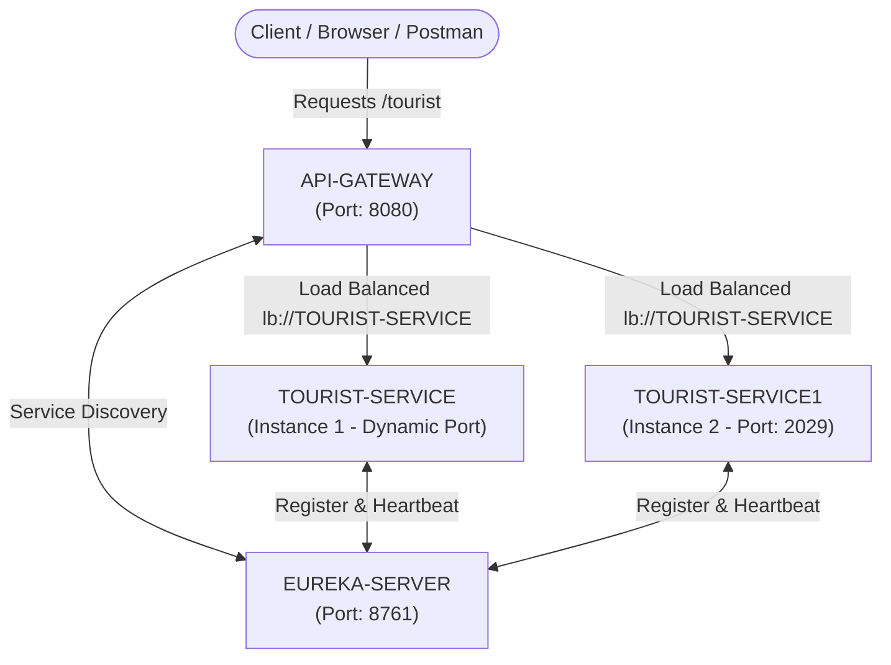

# Tourist Management Microservices (SOA In-Lab)

[](https://www.oracle.com/java/)
[](https://spring.io/projects/spring-boot)
[](https://spring.io/projects/spring-cloud)
[](https://cloud.spring.io/spring-cloud-netflix/)
[](https://spring.io/projects/spring-cloud-gateway)

A Service-Oriented Architecture (SOA) in-lab project demonstrating a scalable Microservices architecture using **Spring Boot**, **Spring Cloud Netflix Eureka** for service discovery, and **Spring Cloud Gateway** with client-side load balancing.

---

## Architecture Overview



---

## Microservices Breakdown

| Microservice | Default Port | Description | Key Dependencies |
| :--- | :--- | :--- | :--- |
| **`EUREKA-SERVER`** | `8761` | Service Registry & Discovery Server. Tracks active microservice instances and health. | `spring-cloud-starter-netflix-eureka-server`, `spring-boot-starter-web` |
| **`API-GATEWAY`** | `8080` | Reverse proxy and single entry point. Routes incoming traffic to registered microservices. | `spring-cloud-starter-gateway`, `spring-cloud-starter-netflix-eureka-client`, `spring-cloud-starter-loadbalancer` |
| **`TOURIST-SERVICE`** | `0` (Dynamic) | Primary instance of Tourist Service; returns service details and runtime port. | `spring-boot-starter-web`, `spring-cloud-starter-netflix-eureka-client` |
| **`TOURIST-SERVICE1`** | `2029` | Replicated instance of Tourist Service for demonstrating load balancing. | `spring-boot-starter-web`, `spring-cloud-starter-netflix-eureka-client` |

---

## Key Features & Implementations

1. **Service Registration & Discovery**:
   - Microservices automatically register with the Eureka Server under application name `TOURIST-SERVICE`.
   - Fast lease renewal and lease expiration intervals configured for responsive local discovery and testing.

2. **API Gateway & Routing**:
   - Single external gateway running on port `8080`.
   - Routes requests matching `/tourist` and `/tourist/**` using the `lb://TOURIST-SERVICE` URI predicate.

3. **Client-Side Load Balancing**:
   - Distributes requests across multiple running instances of `TOURIST-SERVICE` using Spring Cloud LoadBalancer.
   - Dynamic port assignment (`server.port=0`) ensures multiple instances can spin up without port conflicts.

---

## API Endpoints

### 1. Via API Gateway (Recommended)
All requests should normally flow through the API Gateway:

- **URL**: `http://localhost:8080/tourist`
- **Method**: `GET`
- **Response Headers**: `Content-Type: application/json`

#### Sample Response (Instance 1 - Dynamic Port):
```json
{
  "message": "Tourist Service is running",
  "instanceId": "TOURIST-SERVICE:49215",
  "port": 49215
}
```

#### Sample Response (Instance 2 - Port 2029):
```json
{
  "message": "Tourist Service is running",
  "instanceId": "TOURIST-SERVICE:2029",
  "port": 2029
}
```

> **Note**: Consecutive requests to `http://localhost:8080/tourist` will alternate or load-balance across the available instances, demonstrating live traffic distribution.

### 2. Direct Service Endpoints (Testing)
- `GET http://localhost:2029/tourist` — Direct call to `TOURIST-SERVICE1`.
- `GET http://localhost:8761/` — Eureka Dashboard showing all connected services.

---

## Tech Stack & Prerequisites

### Tech Stack
- **Programming Language**: Java 17
- **Framework**: Spring Boot 3.5.4
- **Cloud Components**: Spring Cloud 2025.0.0
- **Build Tool**: Apache Maven 3.8+
- **IDE**: Eclipse / Spring Tool Suite (STS) / IntelliJ IDEA / VS Code

### Prerequisites
- Java Development Kit (JDK) 17 or higher installed:
  ```bash
  java -version
  ```
- Maven installed and added to PATH:
  ```bash
  mvn -v
  ```

---

## Step-by-Step Setup & Running Guide

### 1. Startup Order
To ensure proper discovery and routing, start the services in the following order:

1. **`EUREKA-SERVER`** (Wait until dashboard at `http://localhost:8761` is accessible)
2. **`TOURIST-SERVICE`**
3. **`TOURIST-SERVICE1`**
4. **`API-GATEWAY`**

---

### 2. Running via Terminal (Maven)

#### Step 1: Start Eureka Server
```bash
cd "Skill in sem/TouristMicroservices/EUREKA-SERVER"
mvn spring-boot:run
```

#### Step 2: Start Tourist Service (Instance 1)
Open a new terminal:
```bash
cd "Skill in sem/TouristMicroservices/TOURIST-SERVICE"
mvn spring-boot:run
```

#### Step 3: Start Tourist Service (Instance 2)
Open a new terminal:
```bash
cd "Skill in sem/TouristMicroservices/TOURIST-SERVICE1"
mvn spring-boot:run
```

#### Step 4: Start API Gateway
Open a new terminal:
```bash
cd "Skill in sem/TouristMicroservices/API-GATEWAY"
mvn spring-boot:run
```

---

### 3. Running via Eclipse / Spring Tool Suite (STS)
1. Open Eclipse / STS.
2. Go to **File** > **Import** > **Existing Maven Projects**.
3. Select the `TouristMicroservices` directory and import all 4 projects:
   - `EUREKA-SERVER`
   - `TOURIST-SERVICE`
   - `TOURIST-SERVICE1`
   - `API-GATEWAY`
4. Right-click each main application class > **Run As** > **Spring Boot App** in the specified startup order:
   - `EurekaServerApplication.java`
   - `TouristServiceApplication.java` (in `TOURIST-SERVICE`)
   - `TouristServiceApplication.java` (in `TOURIST-SERVICE1`)
   - `ApiGatewayApplication.java`

---

## Verifying the Deployment

1. **Eureka Dashboard**:
   - Open your browser and navigate to: [http://localhost:8761](http://localhost:8761)
   - Verify that under **Instances currently registered with Eureka**, you see `TOURIST-SERVICE` with 2 instances listed.

2. **Test Load Balancing**:
   - Run the following command in PowerShell or Bash multiple times:
     ```bash
     curl http://localhost:8080/tourist
     ```
   - Notice that the `port` and `instanceId` alternate between the instances, verifying successful client-side load balancing.

---

## Repository Structure

```
Soa-inlab_tourist/
├── .gitignore
├── README.md
└── Skill in sem/
    └── TouristMicroservices/
        ├── EUREKA-SERVER/
        │   ├── pom.xml
        │   └── src/
        │       └── main/
        │           ├── java/com/klu/EurekaServerApplication.java
        │           └── resources/application.properties
        ├── API-GATEWAY/
        │   ├── pom.xml
        │   └── src/
        │       └── main/
        │           ├── java/com/klu/ApiGatewayApplication.java
        │           └── resources/application.properties
        ├── TOURIST-SERVICE/
        │   ├── pom.xml
        │   └── src/
        │       └── main/
        │           ├── java/com/klu/
        │           │   ├── TouristServiceApplication.java
        │           │   ├── controller/TouristController.java
        │           │   └── service/TouristService.java
        │           └── resources/application.properties
        └── TOURIST-SERVICE1/
            ├── pom.xml
            └── src/
                └── main/
                    ├── java/com/klu/
                    │   ├── TouristServiceApplication.java
                    │   ├── controller/TouristController.java
                    │   └── service/TouristService.java
                    └── resources/application.properties
```

---

## Author
Developed for **SOA (Service-Oriented Architecture) In-Lab Assessment**.
